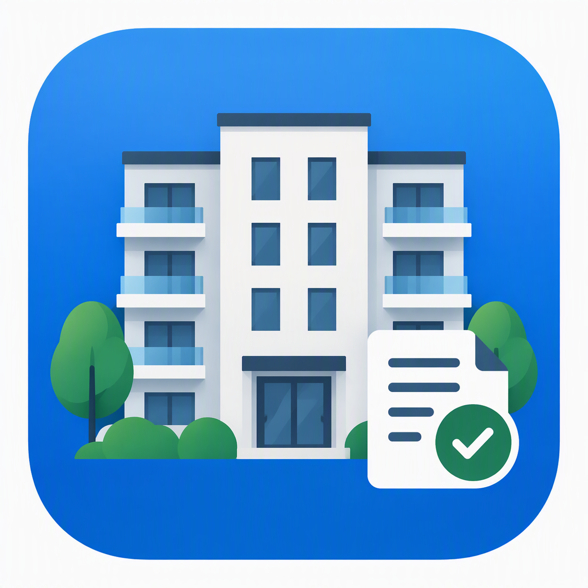

<p align="center">
  
</p>

<h1 align="center">CondominioApp</h1>

<p align="center">
  <em>Assemblee di condominio senza mal di testa: dai condòmini al verbale firmato, in pochi tap.</em>
</p>

<p align="center">
  
  
  
  
</p>

---

## Perché

Chi fa da amministratore (o da segretario volenteroso) in un piccolo condominio sa che la parte noiosa non è l'assemblea:
è **scrivere il verbale** dopo. Contare i presenti, sommare i millesimi, ricordarsi chi aveva la delega di chi, trascrivere
l'esito di ogni votazione con la formula giusta.

CondominioApp fa quella parte per te. Inserisci i condòmini una volta, registri l'assemblea mentre si svolge, e l'app genera
il verbale completo, pronto da copiare o da esportare in PDF.

## Cosa fa

🏠 **Anagrafica condòmini**
Nome, indirizzo e millesimi di ogni condòmino.

📅 **Assemblee ordinarie e straordinarie**
Prima e seconda convocazione, luogo, orario di fine, stato (avvenuta / non avvenuta), presidente e segretario.

🙋 **Presenze e deleghe**
Segni chi c'è e, se qualcuno ha delegato, a chi. Il totale di presenti e millesimi si calcola da solo.

🗳️ **Votazioni pesate per millesimi**
Per ogni punto all'ordine del giorno registri favorevoli, contrari e astenuti. L'app calcola l'esito
(approvato se i millesimi favorevoli superano i contrari) e riconosce l'**unanimità**.

📝 **Argomenti con testo generato in automatico**
Scegli il tipo di argomento e la delibera si scrive da sola, con la formula corretta:

| Tipo | Cosa genera |
|---|---|
| **Bilancio consuntivo** | Approvazione/rigetto del consuntivo dell'esercizio e della ripartizione |
| **Bilancio preventivo** | Approvazione/rigetto del preventivo dell'esercizio e della ripartizione |
| **Dimissioni amministratore** | Accettazione o rigetto delle dimissioni, con motivazione |
| **Elezione amministratore** | Elenco candidati, eletto, luogo e orari di consultazione dei registri (art. 1129–1130 c.c.), eventuale polizza RC |
| **Personalizzato** | Testo libero, con o senza votazione |

📄 **Verbale in un tap**
- **Copia negli appunti** come testo semplice, da incollare in una mail o in un documento
- **Genera PDF** in formato A4, pronto da stampare, firmare o condividere

🔒 **I tuoi dati restano tuoi**
Niente cloud, niente account: tutto è salvato in un database SQLite **cifrato** sul dispositivo.

## Sotto il cofano

L'app segue la **Clean Architecture**, con tre livelli ben separati:

```
lib/
├── domain/          # Entità, use case e logica pura (calcolo esiti, testo delibere, verbale, PDF)
├── data/            # Modelli, repository e accesso a SQLite (con migrazioni versionate)
├── presentation/    # Pagine Flutter e Cubit per lo stato
└── injection_container.dart   # Dependency injection con get_it
```

| Cosa | Con cosa |
|---|---|
| UI | Flutter, Material 3 |
| Stato | [flutter_bloc](https://pub.dev/packages/flutter_bloc) (Cubit) + [equatable](https://pub.dev/packages/equatable) |
| Database | [sqlite3](https://pub.dev/packages/sqlite3) con SQLite3 Multiple Ciphers, eseguito in un Isolate |
| DI | [get_it](https://pub.dev/packages/get_it) |
| PDF | [pdf](https://pub.dev/packages/pdf) + [printing](https://pub.dev/packages/printing) |
| Condivisione | [share_plus](https://pub.dev/packages/share_plus) |

## Come avviarla

Ti serve [Flutter](https://docs.flutter.dev/get-started/install) con Dart 3.9 o successivo.

```bash
git clone https://github.com/NandayDev/CondominioApp.git
cd CondominioApp
flutter pub get
flutter run
```

Per scegliere la piattaforma: `flutter run -d windows`, `-d macos`, `-d linux`, oppure con un telefono o emulatore collegato.

## Da sapere prima di usarla

CondominioApp è nata per un condominio reale ed è ancora un progetto giovane, quindi alcune cose sono scritte direttamente nel codice:

- **Intestazione del verbale**: nome, codice fiscale e indirizzo del condominio sono fissi in
  `lib/domain/logic/verbale_formatter.dart` e `lib/domain/logic/pdf_generator.dart`. Se la usi per il tuo condominio, cambiali lì.
- **Chiave del database**: la password di cifratura è una costante in `lib/data/datasources/database_helper.dart`.
  Cambiala prima di usarla con dati veri.
- **Verbale in seconda convocazione**: il testo dà per scontato che l'assemblea si sia tenuta in seconda convocazione.
- **Calcolo dei quorum**: l'app calcola l'esito sui millesimi dei presenti, ma non verifica i quorum costitutivi e
  deliberativi di legge. Il controllo finale spetta a chi presiede.

## Idee per il futuro

- [ ] Dati del condominio configurabili dall'app
- [ ] Gestione di più condomini
- [ ] Verifica automatica dei quorum
- [ ] Backup ed esportazione del database

Hai un'idea o hai trovato un bug? Apri una [issue](https://github.com/NandayDev/CondominioApp/issues).

---

<p align="center">Fatto con ☕ e Flutter da <a href="https://github.com/NandayDev">NaNDay</a></p>
